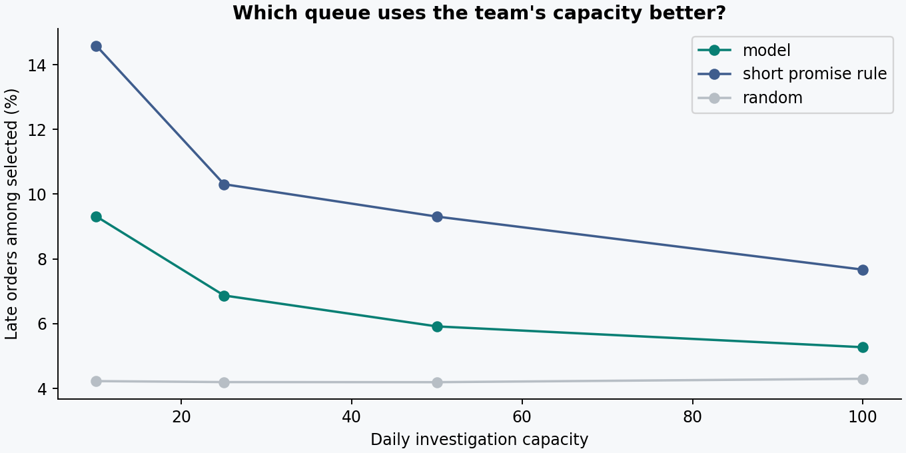
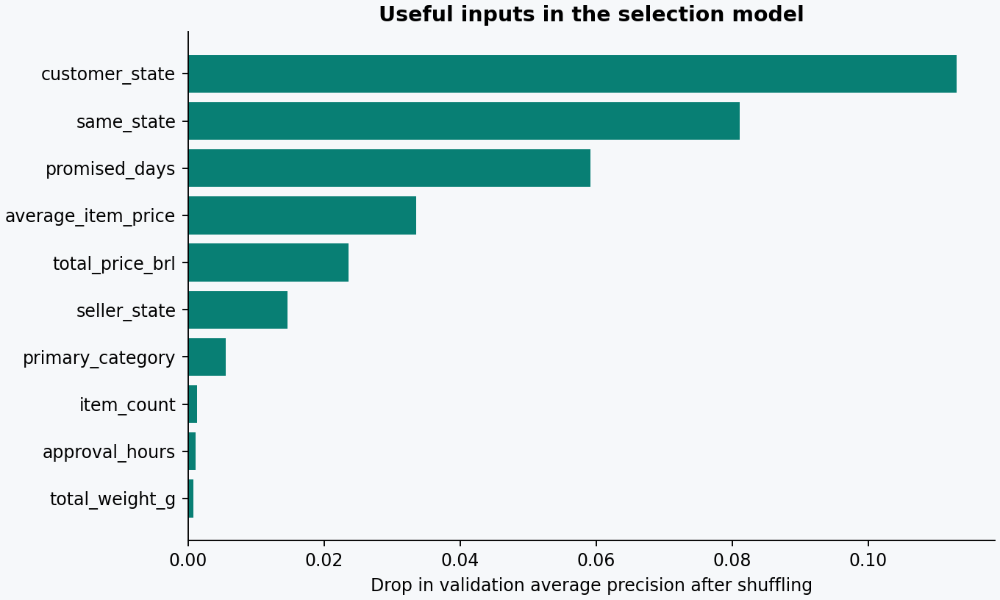

# Evaluation report

Model version: `delaylens-1.0-a967c698-94eced67`. These results come from the saved run in `metrics.json`.

## Decision

**Research only. Do not replace the short-promise rule with this model on the strength of this experiment.** The API is functional, but predictive utility and software functionality are separate questions.

## Data audit

Started with 99,441 orders; retained 95,115. Exclusions are sequential and sum to the difference.

| Exclusion | Orders |
|---|---:|
| not delivered status | 2,963 |
| missing required timestamp | 22 |
| delivered before approval | 61 |
| not exactly one seller | 1,273 |
| input contract failure | 7 |

## Chronological design

| Stage | Retained orders | Late rate | Excluded labels not yet observed |
|---|---:|---:|---:|
| train | 42,847 | 5.66% | 19 |
| validation | 6,812 | 17.37% | 183 |
| calibration | 6,805 | 6.41% | 22 |
| test | 12,304 | 4.87% | 0 |

Training: 2017 approvals, observed deliveries before March 2018. Validation: March approvals, deliveries before May. Calibration: May approvals, deliveries before July. Test: July–August approvals, outcomes recorded in the dataset snapshot. An additional 26,347 eligible orders fall outside the retained windows or maturity filters. Disjoint order IDs are asserted.

No hyperparameters were adjusted after the test results were seen. The implementation was rerun to add reporting and verification; the evaluation choices and model parameters stayed fixed. The temporal gaps reduce outcome-availability leakage but do not remove delivered-only selection bias.

## Selection evidence

| Candidate | Validation AP | ROC AUC | Brier score ↓ |
|---|---:|---:|---:|
| constant prior | 0.1737 | 0.5000 | 0.1572 |
| logistic regression | 0.3243 | 0.6767 | 0.1466 |
| random forest | 0.3194 | 0.6613 | 0.1529 |
| hist gradient boosting | 0.2645 | 0.6501 | 0.1540 |

Logistic regression had the highest validation average precision. The short-promise rule's validation precision at 50/day was 8.39%, compared with 31.87% for the selected classifier. This rule comparison was added to the report after the first test inspection. Its fixed rule and measured March results help explain the reversal; it was not used to retune the model.

The winner was refitted on the retained training and validation rows. A separate sigmoid calibrator was fitted on May. No model was fitted on July–August labels. The operational metric and AP are related but not identical; selection by AP can differ from selection by daily top-K precision.

## Final test

| Quantity | Value |
|---|---:|
| Orders / late orders | 12,304 / 599 |
| Average precision / constant-score AP | 0.0854 / 0.0487 |
| ROC AUC | 0.6495 |
| Calibrated / uncalibrated Brier | 0.046717 / 0.046047 |
| Constant-prior Brier | 0.046889 |
| Reviewed at up to 50/day | 2,772 |
| ML late orders found / missed | 164 / 435 |
| ML false alarms | 2,608 |
| ML precision / recall | 5.92% / 27.38% |
| Rule precision / recall | 9.31% / 43.07% |
| Random expected late orders found | 116.3 |

The test's lower late rate makes raw AP values across periods difficult to compare directly. The observed rank and queue results still deteriorated. Calibration slightly worsened Brier score; it is reported rather than silently removed after seeing the holdout.

## Uncertainty

Whole approval days were resampled 300 times with a fixed model. The percentile 95% intervals are:

- Average precision: 0.0738–0.0994.
- Precision at 50/day: 4.82%–6.93%.
- Recall at 50/day: 20.75%–34.91%.
- Lift over random: 1.17–1.68×.

These intervals reflect sampled-day variation conditional on this model and cohort. They do not include model-selection uncertainty, capture long temporal dependencies, or guarantee future performance. No formal significance claim is made for the difference from the rule.

## Error analysis and explanations

`test_segments.csv` reports states, categories, months, and seen/unseen sellers with at least 100 orders and both classes. Small segments are omitted, not declared reliable. `validation_feature_importance.csv` measures validation AP lost after shuffling each input three times. Correlated inputs can share importance; this is not a causal explanation or a per-order reason.

## What is not demonstrated

Current Brazilian or European delivery performance; results for all approved orders; causal impact of an intervention; actual savings; profitable or fair regional policies; prospective usefulness; cloud latency; continuous monitoring; production operations.

## Next defensible experiment

Treat July–August as already inspected. Do not present it as a fresh holdout after future model changes. Obtain more appropriate data or define a transparent exploratory backtest followed by a new untouched evaluation period. Improve event-time availability, include non-delivery as a separate target if supported, examine multiple cutoffs, and validate a queue policy in shadow mode before operational use.
